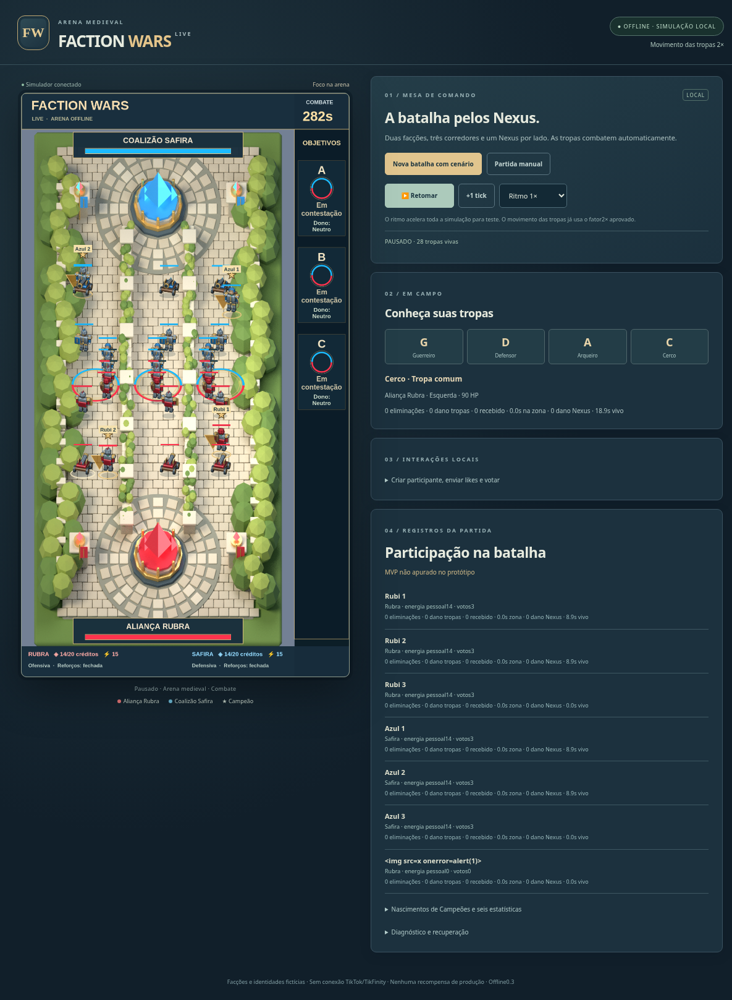

# Faction Wars LIVE 0.4.5 — iniciar pela Games Live

Recepção da audiência: boas-vindas, `!ajuda` / `!help` / `!comandos`, guia na arena e voz em português. O painel permite prévias locais e configurações persistentes. A resposta no chat do TikTok usa o relay do Chatbot, que precisa ser configurado no TikFinity; a conexão de eventos sozinha não envia mensagens. Voz gratuita do navegador ou API Fish Audio pela configuração privada existente do Jelly. Instruções e limites em [PRONTO-PARA-LIVE.md](PRONTO-PARA-LIVE.md).

**[Abrir instruções para a LIVE](PRONTO-PARA-LIVE.md).** O Faction está na biblioteca Games Live com testes locais e controle LIVE. Há também `INICIAR-FACTION-WARS-LIVE.bat`: inicia painel e captura em um só comando. O primeiro `!vermelho` ou `!azul` abre a preparação de 25s; o jogo aguarda sem gastar o relógio antes disso. Sessões de teste são identificadas e não entram na nova LIVE. A sessão LIVE salva pode ser retomada.

# Atualização 0.4.3: composição Figma e navegação pelos corredores

Layout final do arquivo fornecido: fundo inteiro 1080×1920, título e tempo no alto, barras dos Nexus, créditos e objetivos na lateral, marcadores A/B/C nas posições indicadas. As rotas respeitam os 10 bloqueios importados. O motor de combate e o perfil de formação/Cerco 30s permanecem os mesmos.

[Detalhes, testes e limites](docs/ATUALIZACAO_0.4.3.md). Abra o painel em http://127.0.0.1:4173/ e atualize com Ctrl+F5. Fonte de captura: http://127.0.0.1:4176/ (1080×1920). Não é necessário criar partida nova para atualizar a composição; crie Nova partida LIVE quando estiver pronto para receber a audiência.

Testes desta atualização: `npm.cmd run test:layout`, `npm.cmd run test:layout-render`, `node tests/figma-scene.js`, `npm.cmd run test:rules`, `npm.cmd run test:formation`, `npm.cmd run test:sprites`, `npm.cmd run test:medieval`, `npm.cmd run test:live` e `npm.cmd run test:live:http`.

# Atualizacao 0.4.2: spritesheets, formacao e Cerco 30s

[Detalhes, testes e prompts](docs/ATUALIZACAO_0.4.2.md). Inicie uma NOVA partida para aplicar o novo perfil.

# Atualizacao local 0.4.1 - Games Live

Esta pasta e a base atualizada usada pela plataforma. Integra TikFinity local, arte conforme as referencias do proprietario e fonte de captura na porta 4176. Inicie pela biblioteca INICIAR-GAMES-LIVE.bat na pasta superior.

Guia atual e limites: [LEIA-ME-GAMES-LIVE.md](../LEIA-ME-GAMES-LIVE.md). Artes e prompts: [docs/ARTE-E-PROMPTS.md](docs/ARTE-E-PROMPTS.md).

Testes locais: `npm run test:rules`, `npm run test:live`, `npm run integration:check`. O comando historico `npm test` exige evidencias de navegador/stress regeneradas para o novo digest.

---

# Documentacao historica da base 0.4.0

As declaracoes de ausencia de integracao abaixo descrevem a entrega original; para esta atualizacao, consulte o guia acima.

# Faction Wars LIVE — offline0.4.0

Atualização do projeto0.2.0: **Arqueiro sem recuo automático**, arena medieval3D prerenderizada, tropas com armaduras/armas e animações funcionais no Phaser2D. Movimento2× preservado. Os valores de HP/dano/proteção/alcance/cadência e todas as habilidades/economia continuam os aprovados.

[Baixar ZIP0.4.0 no GitHub](https://github.com/LeoDevsn/faction-wars-live/blob/entrega-offline-2026-10-29/FACTION_WARS_OFFLINE_0.4.0.zip)



## Testar fora de casa e preparar integração — versão0.4.0

**Opção escolhida: Netlify. [Passo a passo para gerar o link pelo celular](docs/PUBLICAR_PELO_CELULAR.md).**

[Pacote web pronto para hospedagem](https://github.com/LeoDevsn/faction-wars-live/blob/entrega-offline-2026-10-29/FACTION_WARS_WEB_PREVIEW_0.4.0.zip). É uma batalha real simulada por aparelho, com o mesmo motor/Phaser/regras, independente do PC. **O ZIP não é uma URL publicada:** falta ativar um serviço de hospedagem. O ambiente atual não disponibiliza URL pública e a API do GitHub retornou Forbidden.

Para publicar pela conta do proprietário, Netlify pode importar este repositório privado mediante autorização do próprio GitHub: selecione a branch entrega-offline-2026-10-29, build `node scripts/build-preview.js` e diretório `web-preview`. netlify.toml já traz esses valores. Alternativa: implantação manual do bundle no serviço escolhido ou workflow manual de GitHub Pages (exige Pages habilitado/plano compatível). Não altere a visibilidade do repositório para publicar a prévia. O diretório publicado contém somente os recursos do teste, sem os GDDs/bancos/credenciais.

Prévia local: `npm run build:preview` e `npm run preview`. Teste web: `npm run test:preview`. Exportar diagnóstico gera replay técnico verificável com `node scripts/replay-preview.js arquivo.json`. O navegador armazena eventos/checkpoints por aparelho; o OS pode remover esses dados.

Integração preparada: `npm run integration:check` exercita contrato e WebSocket sintético; `npm run integration:shadow` permanece desativado sem configuração explícita, e o modo sombra nunca aplica eventos reais ao jogo. LikeMode exige verificar se o valor é delta ou contador pessoal; total da sala nunca vira crédito de um usuário. Não há conexão real ou produção habilitada.

Captura vertical: mantenha `npm start` e, em outro terminal, execute `npm run studio`. Use http://127.0.0.1:4175 como fonte Link/Navegador (1080×1920) ou Captura de janela no LIVE Studio. É somente leitura; controle a partida pela interface normal na4173. A transmissão não é iniciada pelo jogo. As versões instaladas do TikFinity/LIVE Studio e um teste real no PC ainda precisam ser validados.

[Guia completo de hospedagem, integração e limites](docs/PREVIEW_E_INTEGRACAO.md) · [ADR0006](docs/adr/0006-web-preview-and-integration-preflight.md).

## Executar no VS Code / Windows

1. Instale Node.js24 (validado24.19.0).
2. Extraia o ZIP em uma pasta nova ou abra o checkout atualizado; abra no VS Code a pasta que contém package.json e src/.
3. No terminal PowerShell, execute:

```powershell
node -v
npm.cmd start
```

Abra http://127.0.0.1:4173 e clique **Nova batalha com cenário → Retomar**. Use **Ritmo1×** para velocidade normal do relógio. O fator2× das tropas já está aplicado; Ritmo4/16× acelera toda a simulação para testes. F5 inicia o servidor pelo debugger do VS Code. Para desligar no terminal: Ctrl+C.

O jogo usa Phaser e arte locais: não precisa instalar node_modules, Blender, Python ou baixar imagens para jogar. Não há CDN em runtime. Dados locais ficam em .runtime/. Não copie dados antigos por cima de outra instalação.

**Inicie uma nova batalha ao atualizar:** journals antigos conservam o perfil original e o comportamento histórico para replay. Somente partidas novas usam archerRetreat:false. A atualização não altera o passado de uma partida registrada.

## Testar no celular — versão0.3.1

Computador e celular na mesma rede Wi-Fi; o jogo continua rodando no PC. Não é necessário instalar Node no celular. Baixe/extraia0.3.1 ou atualize o checkout. Feche terminais de versões anteriores com Ctrl+C antes de iniciar a versão nova.

No terminal do VS Code **no seu computador**, execute:

```powershell
npm.cmd run mobile
```

Esse comando inicia o simulador e mostra os endereços. No Chrome/Android ou Safari/iPhone, abra exatamente o endereço **Celular (Wi-Fi)** exibido; exemplo `http://192.168.1.10:4174`. O IP do exemplo deve ser substituído pelo mostrado no seu terminal. Não use localhost no celular. Clique em **Nova batalha com cenário → Retomar** e mantenha o PC e o terminal ligados. PC e celular compartilham a mesma partida e os controles.

Se o Windows perguntar sobre Node.js no firewall, permita **Redes privadas**. Se não abrir, confirme o endereço IPv4 do Wi-Fi com `ipconfig`, a porta4174 e que os aparelhos estão na rede principal, sem isolamento da rede de convidados. Use `http://`, como impresso no terminal. Os endereços de uma máquina na nuvem/contêiner não equivalem ao IP Wi-Fi do seu PC.

Ctrl+C encerra o acesso da rede local. O comando não cria túnel, publica site ou conecta LIVE/TikTok. `npm start` continua apenas em loopback/porta4173. O acesso móvel é uma ponte local opcional na4174, com origem e Host verificados; não exige alterações no motor ou renderer. Não requer novo npm install.

Validação: `npm run test:mobile` (HTML/assets, POST de controle, stream SSE, origem e ciclo dos processos) e `npm run test:mobile-ui` (Chromium com390px/mobile/touch pela ponte local, seleção e botão Retomar; o teste HTTP/SSE separado usa IP LAN). Não foi testado em Android/iPhone físico nem no roteador/firewall do proprietário. Veja evidence/mobile.json e mobile-browser.json.

## Alterações0.3

- Arqueiro para quando tem alvo válido, ataca normalmente e volta a avançar sem alvo; não retorna ao centro/spawn nem se afasta para manter distância. Disparo Preciso continua ativo.
- Arena vertical1080×1920, piso de pedra, paredes com vegetação e duas áreas abertas nas pontas. Um Nexus azul em cima e um vermelho embaixo; os três corredores compartilham o mesmo Nexus adversário.
- Oito sheets PNG de modelos3D originais:4classes×2facções,32frames cada. Caminhada, ataque, dano e morte em duas direções,4poses por ação/direção. Não são modelos3D em tempo real. Campeões têm escala visual maior, manto/estrela/anel dourados, nome e cooldown.
- Objetivos circulares no piso, sem caixas grandes no meio da batalha. Progresso circular e duas cores quando contestados. Sidebar OBJETIVOS A/B/C identifica estado e dono real. Contestação não transfere posse.
- Interface de cada Nexus: somente facção e barra de vida. A estrutura continua2000HP, sem redução de dano, destruída em HP0 e com ataque automático aprovado.

O renderer interpola snapshots confirmados20Hz e apresenta efeitos; não decide dano, captura ou vitória. Paredes/sprites não introduzem colisores. Projéteis são cosméticos. Resultados continuam3×5s e informam MVP não apurado no protótipo.

## Continuar com Codex no VS Code

[Texto pronto para colar e instruções](docs/CONTINUIDADE_VSCODE.md). [Decisões atuais / ADR0005](docs/adr/0005-medieval-no-archer-retreat.md). [Evidências e limitações](docs/EVIDENCIAS.md). [Arquivos alterados](docs/ALTERACOES_0.3.md).

## Testes

```sh
node tests/medieval.js
npm run test:movement
npm run test:ui
npm run test:medieval-ui
npm run test:render
npm test
npm run build
```

`medieval` testa ausência de recuo/disparo contínuo/avanço,24casos classe×facção×rota alcançando/atacando Nexus, estado de objetivos, replay0.2, falha transacional e regras numéricas. `test:movement` testa2×, cadências/captura/relógio e replay0.1. `npm test` executa L01–L40 (L15 atualizado pela decisão atual). Testes de navegador exigem Chromium no PATH; as medições entregues foram Linux/Chromium154, headless/software. Windows teve resolução de caminhos simulada, sem ensaio físico Windows. Registre skip se uma dependência de teste estiver indisponível; não apresente análise como execução.

Os testes de aceitação conferem hashes das evidências. Após editar src/, profiles/ ou scenarios/, regenere evidências da mesma versão antes de executar a matriz completa. Para regenerar usando os nomes do runner, arquive bancos existentes com esses nomes antes de repetir:

```sh
node scripts/scenario.js phaser-battle-1
node scripts/scenario.js phaser-battle-2
node scripts/stress.js --paced --final
node scripts/replay.js .runtime/stress-medieval-03-0.sqlite > evidence/stress-fresh-03-0.json
node scripts/replay.js .runtime/stress-medieval-03-1.sqlite > evidence/stress-fresh-03-1.json
node scripts/promote-stress.js
node tests/medieval.js
npm run test:movement
npm run test:ui
npm run test:medieval-ui
npm run test:render
npm run build
node scripts/clean-smoke.js
npm test
node scripts/report.js
```

O stress dura10min reais, com12000ticks/60000eventos e SQLite durável, depois replays. HP elevado e ondas desativadas são exclusivamente fixtures de carga para manter122entidades vivas; não são mudanças do jogo. `test:render` mede10s estáticos e10s animados com122sprites reais. Métricas são locais e não garantem60FPS em qualquer máquina.

Cenário livre: `npm run scenario`. Replay técnico: `npm run replay -- .runtime/<id-impresso>.sqlite`. Não é vídeo nem tela extra. Build: dist/ executa com `npm start`; o runtime ws do relay está incluído em node_modules no bundle. Os testes/documentos completos ficam na raiz do projeto.

## Fontes de arte e dependências

Modelos/arena editáveis em `src/ui/assets/*.blend` e `scripts/render-medieval.py`. O script gera a arena no Cycles/CPU48samples e as tropas com luz de estúdio no Workbench. A montagem das sheets usa Pillow em `scripts/assemble-medieval.py`. Para recriar arte, instale Blender4.3.2 e Python/Pillow, execute `npm run assets:medieval`. Isso não é necessário para jogar. O script SVG0.2 permanece histórico em `scripts/generate-art.js`; `npm run assets` regenera apenas aquela arte antiga, não o visual atual.

Phaser3.90.0 fixado no lockfile, build oficial/licença/SHA em src/ui/vendor/. Para desenvolver/recriar vendor: `npm ci --ignore-scripts` e `npm run vendor`. Não existem dependências baixadas dinamicamente pelo jogo.

Fontes originais do pacote em sources/ são preservadas byte a byte; GDD original não foi alterado. ADRs documentam as substituições aprovadas. Não há publicação do jogo, conexão TikTok/TikFinity/LIVE, XP real, ranking, temporadas, conquistas, recompensas ou fórmula final de MVP. O repositório/ZIP é a entrega offline.

SHA256SUMS.txt descreve o ZIP completo. Git ignora .runtime/ e dist/; gere os cenários/build se precisar desses arquivos no checkout. Evidências de versões anteriores são históricas e não contam como execução atual.
